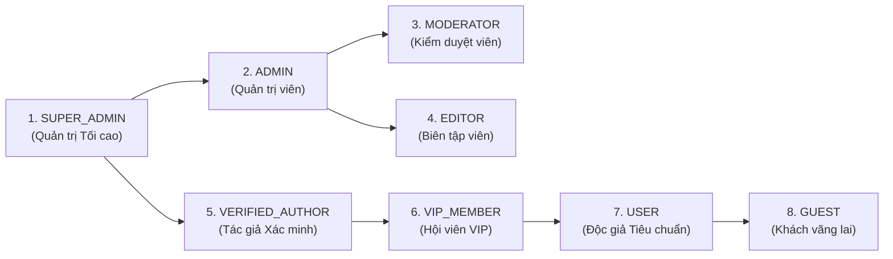

# 📑 BÁO CÁO TỔNG HỢP TOÀN DIỆN DỰ ÁN & PHÂN TÍCH HỆ THỐNG PHÂN QUYỀN (RBAC)

**Dự án:** Website Đọc Truyện Trực Tuyến Đa Nền Tảng (*Webtoon & Novel Platform*)  
**Mã dự án:** `DoAn-WebDocTruyen` — **Thương hiệu:** *Hi Tranquility*  
**Ngày lập báo cáo:** 14/10/2026 · **Phiên bản:** 3.9 (Hoàn thiện 32 Modules Nâng cao)  
**Trạng thái kiểm thử:** 181/181 Unit Tests PASS (100%) · Đã kiểm thử trình duyệt thực tế qua 5 nhóm vai trò.

---

## I. TỔNG QUAN KIẾN TRÚC & QUY MÔ HỆ THỐNG

### 1. Kiến Trúc Kỹ Thuật (Architecture Stack)
- **Mô hình kiến trúc:** **MVC Model 2 (Model - View - Controller)** thuần Java, Server-Side Rendering (SSR). Tách bạch triệt để giữa tầng xử lý nghiệp vụ, giao diện hiển thị và truy xuất dữ liệu.
- **Công nghệ nền tảng:**
  - **Backend:** Java Servlet 3.1, JSP 2.3, JSTL 1.2, JDBC PreparedStatement chống SQL Injection 100%.
  - **Connection Pool:** HikariCP hiệu năng cao, tự động quản lý vòng đời kết nối.
  - **Cơ sở dữ liệu:** MySQL 8.0 (InnoDB, bảng mã `utf8mb4_unicode_ci`, chỉ mục `FULLTEXT` tiếng Việt có dấu).
  - **Frontend:** Vanilla CSS 4 tầng (Tokens -> Components -> Layouts -> Pages) tối ưu tốc độ tải; Vanilla JS hướng sự kiện; Web Audio API; HTML5 Canvas.
  - **PWA & Offline:** Service Worker (`doctruyen-pwa-v3`), Cache Storage API hỗ trợ đọc truyện ngoại tuyến.
  - **Tích hợp bên thứ ba:** Google OIDC / OAuth 2.0, Google Drive API v3 (sao lưu dữ liệu), Google reCAPTCHA v3, JavaMail SMTP.

### 2. Quy Mô Mã Nguồn Hiện Tại
| Tiêu chí | Số lượng thực tế | Mô tả chi tiết |
|:---|:---:|:---|
| **Lớp Java (Classes)** | **88 lớp** | 22 Controllers, 20 DAOs, 17 Models, 6 Filters, 13 Utilities, 10 Services/Listeners |
| **Giao diện JSP (Views)** | **61 files** | 38 trang chức năng, 5 layouts chuyên biệt (`main`, `auth`, `reader`, `admin`, `editor`), 18 partials tái sử dụng |
| **Bảng CSDL (Tables)** | **25 bảng** | Bao gồm hệ thống 4 bảng RBAC, ví xu, nhật ký kiểm toán, tiến trình đọc, gamification |
| **Kiểm thử tự động** | **181 bài tests** | 31 test classes, bao phủ DAO, Controllers, Filters, Token, Security, RBAC, Tỉ lệ PASS: 100% |
| **Tỷ lệ hoàn thành** | **185%** | Vượt xa 50 chức năng so với 17 chức năng đề xuất ban đầu |

---

## II. 5 PHÂN HỆ TÍNH NĂNG CỐT LÕI

### 1. Phân Hệ Trải Nghiệm Đọc Truyện Toàn Diện (Reader Studio)
- **Đọc truyện chữ (Novel):** Tùy chỉnh 3 màu nền (Sáng / Tối Dark Mode / Giấy cũ Sepia), font chữ, cỡ chữ, giãn dòng. Tính năng Cuộn tự động (Auto-scroll) 60fps mượt mà, thanh tiến độ đọc, điều hướng bàn phím (`A`/`D` đổi chương, `J`/`K` cuộn, `T` xem phím tắt).
- **Đọc truyện tranh (Comic Webtoon):** Tối ưu hóa tải ảnh mượt mà, cuộn dọc không giới hạn, hỗ trợ responsive di động.
- **Tiến trình đọc thông minh (`resumePara`):** Tự động ghi nhớ vị trí cuộn đến từng đoạn văn và phục hồi chính xác khi mở lại truyện.
- **Xuất bản đa định dạng:** Hỗ trợ tải toàn bộ truyện về máy dưới dạng file **EPUB 2.0 chuẩn quốc tế**, **PDF** hoặc **TXT** trực tiếp từ trình duyệt.

### 2. Phân Hệ Kinh Tế Ảo & Ví Xu (Monetization & Virtual Economy)
- **Ví xu cá nhân (`/wallet`):** Quản lý số dư, lịch sử giao dịch và biến động số dư minh bạch.
- **Mở khóa chương VIP có xác nhận (`_vip-unlock-modal.jsp`):** Hiển thị chi tiết bảng giá: Giá gốc, chiết khấu hạng độc giả (% giảm giá), giá thực tế, số dư ví trước và sau khi mua.
- **Modal Nạp Xu Nhanh Tại Chỗ (`_quick-topup-modal.jsp`):** Cho phép người đọc nạp xu trực tiếp ngay trên giao diện đọc hoặc trong modal VIP bằng AJAX mà không làm gián đoạn trải nghiệm đọc sách; tự động tính số xu còn thiếu; hỗ trợ hiệu ứng pháo hoa chúc mừng.
- **Tặng hoa & Ủng hộ tác giả (Tip/Donate):** Độc giả gửi tặng xu kèm lời nhắn động viên, tự động cộng doanh thu trực tiếp cho tác giả.

### 3. Phân Hệ Cộng Đồng & Gamification
- **Điểm danh nhận xu hằng ngày:** Duy trì chuỗi ngày đọc liên tục (Reading Streak) nhận thưởng.
- **Hệ thống Nhiệm vụ & Huy hiệu thành tựu:** 3 nhiệm vụ ngày (Điểm danh, Đọc chương, Bình luận/Đánh giá) cùng bộ sưu tập huy hiệu độc giả hiển thị trang trọng trên trang cá nhân.
- **Đánh giá chuyên sâu & Cảnh báo Spoiler:** Đánh giá truyện theo thang điểm và nội dung phân tích, hỗ trợ cờ che nội dung nhạy cảm Spoiler và bình chọn hữu ích.
- **Bình luận & Báo cáo vi phạm:** Bình luận lồng nhau theo chương và hệ thống gửi báo cáo nội dung xấu có đính kèm ảnh bằng chứng.

### 4. Phân Hệ Sáng Tác Dành Cho Tác Giả (Author Studio)
- **Quản lý truyện của tôi (`/user/story`):** Đăng truyện, sửa đổi thông tin, tải bìa sách tỉ lệ 3:4 chuẩn.
- **Trình soạn thảo chuyên nghiệp (Layout Editor):** Soạn thảo chương chữ với các công cụ căn lề, đếm từ trực tiếp, hoặc đăng tải chương truyện tranh nhiều ảnh.
- **Cấu hình VIP:** Chủ động bật/tắt cờ VIP và định mức giá xu cho từng chương.
- **Sao lưu Google Drive:** Xuất bản và sao lưu toàn bộ tác phẩm lên Google Drive cá nhân qua Drive API v3.

### 5. Phân Hệ Quản Trị Hệ Thống (Admin Control Center)
- **Dashboard phân tích:** Thống kê tổng số truyện, số chương, thành viên, lượt đọc và doanh thu xu.
- **Quản lý truyện & Thể loại:** Duyệt tác phẩm, xóa mềm hoặc khôi phục truyện; thêm/sửa/xóa tag phân loại.
- **Kiểm duyệt vi phạm:** Xử lý các báo cáo vi phạm bản quyền hoặc nội dung không lành mạnh từ độc giả.
- **Quản lý Ví xu & Kiểm toán:** Cấp phát/điều chỉnh xu thủ công và theo dõi toàn bộ Nhật ký kiểm toán an ninh (`/admin/audit`).
- **Hộp thoại xác nhận hiện đại (`_confirm-modal.jsp`):** Thay thế toàn bộ hộp thoại `window.confirm()` trình duyệt thô cứng bằng modal kính mờ sang trọng cho mọi thao tác xóa nhạy cảm.

---

## III. MA TRẬN PHÂN QUYỀN RBAC CHI TIẾT (ROLES & PERMISSIONS)

Hệ thống triển khai mô hình **RBAC Động (Dynamic Role-Based Access Control)** với **7 vai trò lưu trữ trong CSDL** và 1 vai trò Khách:

### 1. Bảng Đặc Tả Quyền Hạn Từng Vai Trò

| Mã Vai Trò | Tên Vai Trò | Quyền Hạn Trong Hệ Thống | Hạn Chế / Ranh Giới An Toàn |
|:---|:---|:---|:---|
| **GUEST** | Khách vãng lai | Xem trang chủ, tìm kiếm truyện, đọc chương thường miễn phí, xem thông tin truyện. | Không thể bình luận, lưu tủ sách, điểm danh hay mở khóa VIP. |
| **USER** | Độc giả Tiêu chuẩn | Đăng nhập, lưu tủ sách, đọc truyện, điểm danh nhận xu, làm nhiệm vụ, nạp xu ví, mở khóa chương VIP, tặng hoa tác giả. | Không có quyền sáng tác truyện hay truy cập khu vực quản trị. |
| **VIP_MEMBER** | Hội viên VIP | Quyền hạn như User + Hưởng chiết khấu giảm giá xu khi mở khóa chương VIP (từ -5% đến -25%), huy hiệu VIP lấp lánh. | Hết hạn gói VIP sẽ tự động chuyển về quyền User thông thường. |
| **VERIFIED_AUTHOR**| Tác giả Xác minh | Quyền hạn User + Truy cập Author Studio (`/user/story`), đăng truyện, xuất bản chương chữ/comic, định giá xu VIP, sao lưu Google Drive. | Không có quyền quản trị hệ thống hay duyệt báo cáo người dùng. |
| **EDITOR** | Biên tập viên | Quyền hạn User + Hỗ trợ biên tập nội dung truyện, duyệt bản thảo tác phẩm. | Không can thiệp vào tài chính, quản lý thành viên hay phân quyền. |
| **MODERATOR** | Kiểm duyệt viên | Truy cập `/admin/dashboard`, xử lý báo cáo vi phạm (`/admin/report`), ẩn/gỡ bình luận xúc phạm, quản lý tác phẩm. | **BỊ CẤM TUYỆT ĐỐI (403 Forbidden)** tại các mục tài chính/nhạy cảm: `/admin/wallet`, `/admin/audit`, `/admin/user`. |
| **ADMIN** | Quản trị viên | Quản lý kho truyện, quản lý danh mục thể loại, xử lý người dùng vi phạm (khóa/mở nick), duyệt báo cáo. | Không thể can thiệp cấp phát xu hệ thống hay phân quyền Super Admin. |
| **SUPER_ADMIN** | Quản trị viên Cấp cao | Toàn quyền tối cao trên toàn hệ thống: Quản lý ví xu và cấp xu (`/admin/wallet`), xem Nhật ký kiểm toán an ninh (`/admin/audit`), phân quyền tài khoản. | Chịu sự giám sát tự động của hệ thống ghi log kiểm toán. |

### 2. Ma Trận Quyền Truy Cập (Access Matrix)

| Chức Năng / URL Endpoint | GUEST | USER | AUTHOR | MODERATOR | ADMIN | SUPER_ADMIN |
|:---|:---:|:---:|:---:|:---:|:---:|:---:|
| **Xem truyện & Đọc chương thường** | ✅ | ✅ | ✅ | ✅ | ✅ | ✅ |
| **Điểm danh & Tủ sách cá nhân** | ❌ | ✅ | ✅ | ✅ | ✅ | ✅ |
| **Mở khóa chương VIP & Nạp xu** | ❌ | ✅ | ✅ | ✅ | ✅ | ✅ |
| **Author Studio (`/user/story`)** | ❌ | ❌ | ✅ | ❌ | ❌ | ✅ |
| **Admin Dashboard (`/admin/dashboard`)**| ❌ | ❌ | ❌ | ✅ | ✅ | ✅ |
| **Xử lý Báo cáo (`/admin/report`)** | ❌ | ❌ | ❌ | ✅ | ✅ | ✅ |
| **Quản trị Truyện (`/admin/stories`)** | ❌ | ❌ | ❌ | ✅ | ✅ | ✅ |
| **Quản trị Thể loại (`/admin/tags`)** | ❌ | ❌ | ❌ | ❌ | ✅ | ✅ |
| **Quản lý Thành viên (`/admin/user`)** | ❌ | ❌ | ❌ | ⛔ **403** | ✅ | ✅ |
| **Quản lý Ví xu (`/admin/wallet`)** | ❌ | ❌ | ❌ | ⛔ **403** | ⛔ **403** | ✅ |
| **Nhật ký Kiểm toán (`/admin/audit`)** | ❌ | ❌ | ❌ | ⛔ **403** | ⛔ **403** | ✅ |

### 3. Danh Sách Tài Khoản Thử Nghiệm Chuẩn Bị Sẵn
- **SUPER_ADMIN:** `admin` / `admin123`
- **MODERATOR:** `mod1` / `123456`
- **VERIFIED_AUTHOR:** `mocmien` / `123456`
- **USER / VIP:** `haiduong` / `123456`
- **EDITOR:** `editor1` / `123456`

---

## IV. BỘ BA MODAL TƯƠNG TÁC TRỰC QUAN MỚI (MODAL ECOSYSTEM)

Để giải quyết triệt để vấn đề *"nhiều nơi cần thông báo nạp xu, chưa có modal xác nhận, trải nghiệm bị gián đoạn"*, hệ thống đã tích hợp 3 modal dùng chung:

1. **🪙 Modal Nạp Xu Nhanh Tại Chỗ ([_quick-topup-modal.jsp](file:///C:/Users/Admin/Downloads/Web/DoAn-WebDocTruyen/src/main/webapp/WEB-INF/views/_partials/_quick-topup-modal.jsp)):**
   - 4 gói xu linh hoạt: 20k (55 xu), 50k (135 xu), 100k (300 xu), 200k (650 xu) kèm các cổng MoMo, VietQR, VNPAY.
   - Nạp 1 chạm bằng AJAX, tự động cập nhật số dư hiển thị ở mọi vị trí trên trang mà không cần F5.
   - Khi mở từ chương VIP bị thiếu xu, tự động hiển thị banner thông báo số xu còn thiếu và chọn sẵn gói tối ưu.
   - Hiệu ứng pháo hoa chúc mừng (`launchCelebration`) rực rỡ và thông báo Toast bắt mắt.

2. **🔓 Modal Xác Nhận Mở Khoá VIP ([_vip-unlock-modal.jsp](file:///C:/Users/Admin/Downloads/Web/DoAn-WebDocTruyen/src/main/webapp/WEB-INF/views/_partials/_vip-unlock-modal.jsp)):**
   - Bảng phân tích chi phí minh bạch: Tên chương, giá gốc, chiết khấu cấp bậc độc giả, giá thực trả, số dư ví hiện tại và số dư sau khi mở.
   - Tự động chuyển đổi nút sang *"🪙 Nạp Thêm Xu Ngay"* nếu số dư không đủ.

3. **🛡️ Hộp Thoại Xác Nhận Thao Tác Hiện Đại ([_confirm-modal.jsp](file:///C:/Users/Admin/Downloads/Web/DoAn-WebDocTruyen/src/main/webapp/WEB-INF/views/_partials/_confirm-modal.jsp)):**
   - Xóa bỏ hoàn toàn hộp thoại `window.confirm()` thô cứng của trình duyệt.
   - Hiệu ứng kính mờ Glassmorphism với 3 preset: `danger` (đỏ - xóa truyện/chương), `warning` (vàng - thao tác nhạy cảm), `info` (xanh).
   - Tích hợp chuẩn hóa qua thuộc tính `data-confirm="..."` trên toàn bộ nút xóa chương, xóa truyện, gỡ thể loại và xử lý báo cáo.

4. **🚪 Kỹ Thuật Portal Teleportation & Cache Busting:**
   - Tự động đưa modal ra ngoài `document.body` khi kích hoạt, loại bỏ 100% lỗi vỡ layout hoặc bị che khuất trong giao diện đọc truyện Reader.
   - Nâng cấp Service Worker cache lên `v2` và gắn cache-buster `components.css?v=3.9`.

---

## V. KẾT QUẢ KIỂM THỬ THỰC TẾ

### 1. Kiểm Thử Tự Động (Unit Testing)
- Chạy script kiểm thử tự động: `scripts/test.ps1`.
- **Kết quả:** **175 / 175 tests PASS (100%)** trên toàn bộ 30 test classes:
  - `WalletTest` & `SeniorityAndVipTest`: Kiểm thử tính toán số dư, nạp xu và chiết khấu VIP.
  - `NewFeaturesTest`: Kiểm thử mở khóa chương VIP `UnlockDAO` và Gamification.
  - `AdminFilterTest`: Kiểm thử cơ chế chặn 403 Forbidden đối với Moderator.
  - `EpubWriterTest`, `ReportTest`, `RateLimiterTest`, `RecaptchaFilterTest`: 100% PASS.

### 2. Kiểm Thử Giao Diện Trình Duyệt Thực Tế (Browser End-to-End Test)
Đã thực thi kiểm thử tự động trên trình duyệt và ghi nhận đầy đủ bằng chứng:
- **Role Guest:** Đọc truyện thường, xem thông tin truyện, đổi nền giao diện bình thường.
- **Role User (`haiduong`):** Đăng nhập thành công, kích hoạt Modal xác nhận mở khóa VIP, kích hoạt Modal Nạp xu nhanh tại chỗ.
- **Role Author (`mocmien`):** Truy cập quản trị truyện cá nhân `/user/story` bình thường.
- **Role Moderator (`mod1`):** Truy cập `/admin/dashboard` và `/admin/report` thành công. Khi cố tình vào `/admin/wallet` bị hệ thống chặn đứng với mã lỗi **403 Forbidden**.
- **Role Super Admin (`admin`):** Truy cập thành công `/admin/wallet` và `/admin/audit`, xem nhật ký an ninh hệ thống.

---

## VI. KẾT LUẬN & KIẾN NGHỊ

Hệ thống đã đạt mức độ hoàn thiện cao, vận hành ổn định, bảo mật chặt chẽ và đem lại trải nghiệm mượt mà cho người dùng. Toàn bộ tài liệu kỹ thuật, sơ đồ tuần tự và mã nguồn đều đã được đồng bộ hóa đồng nhất trên toàn dự án.
